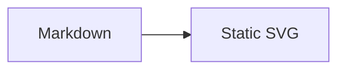

# pele-x

Astro, Starlight and mdast integrations for [Pele](https://pele.run), the fast Mermaid-to-SVG renderer.

Mermaid fences render to static, themeable SVG at build time. The browser gets no Pele JavaScript unless you opt into pan and zoom.

## Packages

| Package | Purpose |
|---|---|
| `@pele-x/mdast` | Core renderer plus remark and Sätteri adapters |
| `@pele-x/astro` | Astro integration, `<Pele />` component, neutral theme and zoom script |
| `@pele-x/starlight` | Starlight plugin and light/dark theme |

The packages are private at `0.1.0` until the npm scope is set.

## Starlight

```js
// astro.config.mjs
import { defineConfig } from 'astro/config';
import starlight from '@astrojs/starlight';
import starlightPele from '@pele-x/starlight';

export default defineConfig({
	integrations: [starlight({ title: 'Docs', plugins: [starlightPele()] })],
});
```

Then use a normal Mermaid fence:

````md

````

Add `zoom` to a fence for pan and zoom, or pass `starlightPele({ zoom: true })` to enable it everywhere.

## Astro

```js
import { defineConfig } from 'astro/config';
import pele from '@pele-x/astro';

export default defineConfig({
	integrations: [pele()],
});
```

For plain remark or Sätteri pipelines, import `remarkPele` from `@pele-x/mdast/remark` or `satteriPele` from `@pele-x/mdast/satteri`.

## Development

```sh
bun install
bun run check          # lint, typecheck, unit tests, builds, e2e, package checks
bun run --cwd apps/docs dev
```

The Starlight documentation site lives in `apps/docs`; the end-to-end fixture is `examples/astro-basic`.

## Layout

- `packages/mdast` — rendering, fence metadata, ids, error handling, remark/Sätteri adapters
- `packages/astro` — processor injection, zoom island, component, theme
- `packages/starlight` — Starlight plugin and theme mapping
- `apps/docs` — guides, gallery and troubleshooting
- `examples/astro-basic` — Sätteri, Unified, MDX and zoom fixture
- `docs/plans` — design, machine plan and build record
