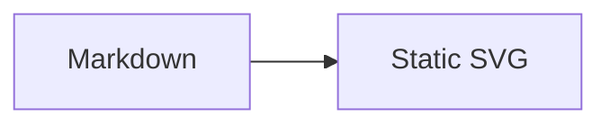

# pele-x

Astro, Starlight and mdast integrations for [Pele](https://pele.run), the fast Mermaid-to-SVG renderer.

Mermaid fences render to static, themeable SVG at build time. The browser gets no Pele JavaScript unless you opt into pan and zoom.

**Docs preview:** https://t128n.github.io/pele-x/

## Packages

| Package          | Purpose                                                                |
| ---------------- | ---------------------------------------------------------------------- |
| `mdast-pele`     | Core renderer plus remark and Sätteri adapters                         |
| `astro-pele`     | Astro integration, `<Pele />` component, neutral theme and zoom script |
| `starlight-pele` | Starlight plugin and light/dark theme                                  |

Published as `mdast-pele`, `astro-pele`, and `starlight-pele`.

## Starlight

```sh
npm install starlight-pele
```

```js
// astro.config.mjs
import { defineConfig } from 'astro/config';
import starlight from '@astrojs/starlight';
import { starlightPele } from 'starlight-pele';

export default defineConfig({
	integrations: [starlight({ title: 'Docs', plugins: [starlightPele()] })],
});
```

Then use a normal Mermaid fence:

````md

````

Add `zoom` to a fence for pan and zoom, or pass `starlightPele({ zoom: true })` to enable it everywhere.

## Astro

```sh
npm install astro-pele pele
```

```js
import { defineConfig } from 'astro/config';
import { pele } from 'astro-pele';

export default defineConfig({
	integrations: [pele()],
});
```

For plain remark or Sätteri pipelines, install `mdast-pele` and import `remarkPele` from `mdast-pele/remark` or `satteriPele` from `mdast-pele/satteri`.

## Development

```sh
bun install
bun run check          # lint, typecheck, unit tests, builds, e2e, package checks
bun run --cwd apps/docs dev
```

The Starlight documentation site lives in `apps/docs`; the end-to-end fixture is `examples/astro-basic`.

An hourly GitHub Actions workflow tracks new [Pele](https://www.npmjs.com/package/pele) releases, runs CI on the update, and merges patch and minor releases. See [docs/dependency-updates.md](docs/dependency-updates.md) for the flow and repository settings.

## Layout

- `packages/mdast` — rendering, fence metadata, ids, error handling, remark/Sätteri adapters
- `packages/astro` — processor injection, zoom island, component, theme
- `packages/starlight` — Starlight plugin and theme mapping
- `apps/docs` — guides, gallery and troubleshooting
- `examples/astro-basic` — Sätteri, Unified, MDX and zoom fixture
- `docs/plans` — design, machine plan and build record
