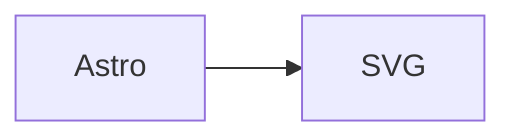

---

title: Astro integration
description: Add static Mermaid diagrams directly to an Astro site.
---

Use `@pele-x/astro` when your site does not use Starlight. Add `pele()` to the integrations in `astro.config.mjs`:

```js
import { pele } from '@pele-x/astro';
import { defineConfig } from 'astro/config';

export default defineConfig({
	integrations: [pele()],
});
```

The integration supports Astro's default `satteri()` processor and the `unified()` processor from `@astrojs/markdown-remark`. It selects the matching adapter automatically.

Import `@pele-x/astro/theme.css` for a neutral light and dark diagram theme. Then add a fence to any Markdown or MDX page:



Zoom is disabled by default. Enable it for every diagram with `pele({ zoom: true })`, or only for fences carrying the `zoom` metadata marker with `pele({ zoom: 'marked' })`.
