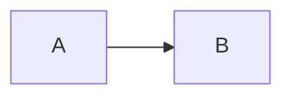
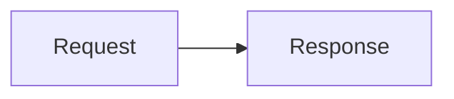

## Fence languages

Use `mermaid` or `pele` as the fence language. Names are case-sensitive; other languages remain ordinary code blocks.

````md

````

## Captions and zoom

Add `title="..."` to display a figcaption. Single-quoted titles are also supported. When the integration uses `zoom: 'marked'`, add the standalone `zoom` marker to enable pan and zoom for that diagram.

````md

````

Enable zoom everywhere with `zoom: true`. Without a zoom option, diagrams have no zoom script or zoom marker.

## Multiple diagrams

Any number of fences can appear on a page. Each fence is rendered independently and receives a deterministic prefix based on its file, position, and source so repeated diagrams do not share generated accessibility ids.

## Error modes

The `errorMode` option controls invalid diagrams:

- `throw` stops the build and includes the source file and mapped line.
- `placeholder` renders an escaped, readable error in a `<pre>` element.
- `warn` reports a warning and renders the same placeholder.

Builds default to `throw`; development and preview default to `placeholder`. An explicit option always wins.

## MDX

Fences work in MDX as well as Markdown. Mermaid labels containing braces, such as `B{Works?}`, remain diagram text rather than becoming MDX expressions.
