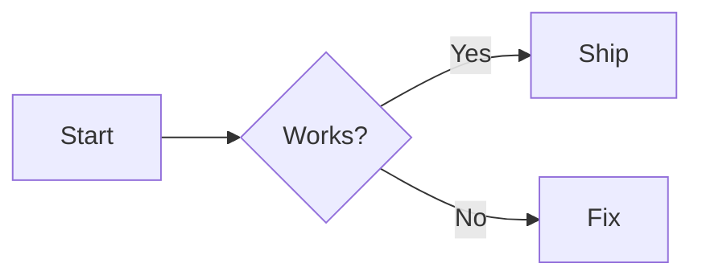
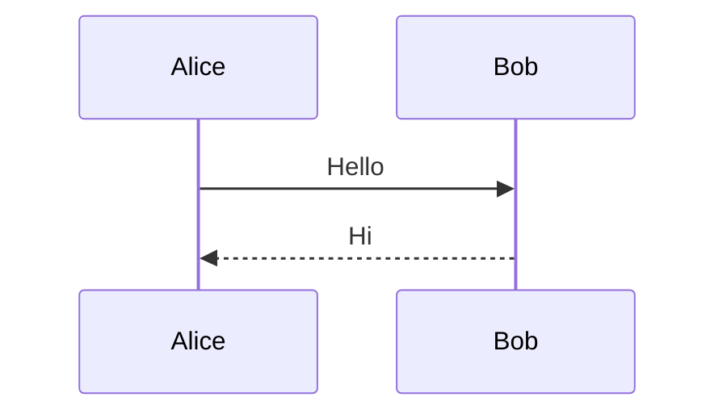
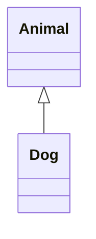
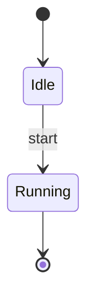
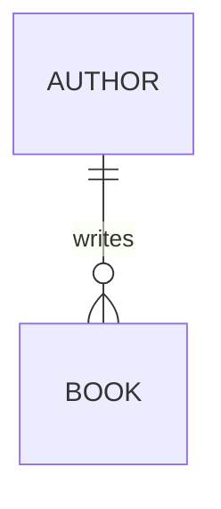
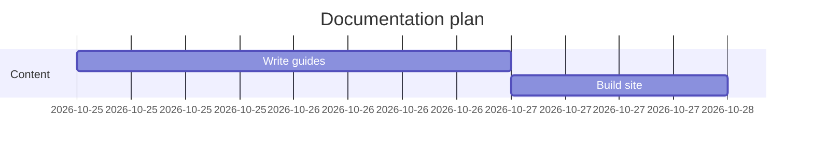
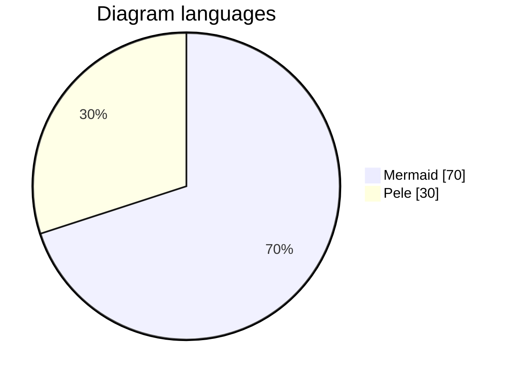
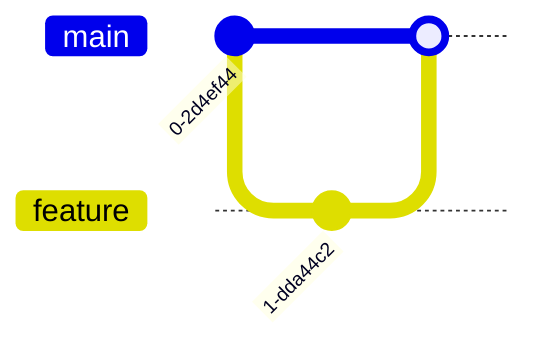

Each example is rendered to static SVG during the documentation build.

## Flowchart

The decision label `B{Works?}` also verifies that braces in MDX fences remain diagram text.

## Sequence

## Class

## State

## Entity relationship

## Gantt

## Pie

## Git

