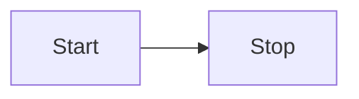

---

title: Get started with mdast
description: Render Mermaid fences through the mdast-pele remark or Sätteri adapters.
---

This guide uses `mdast-pele` to render Mermaid fences in a unified, remark, or Sätteri pipeline. By the end you will have a renderer that turns fences into static SVG without a browser-side Mermaid runtime.

`mdast-pele` is also the renderer behind `astro-pele` and `starlight-pele`. Use it directly when your Markdown pipeline is not Astro's built-in processor.

## Install the package

```sh
bun add mdast-pele
```

`pele` is installed automatically as a dependency. The package is ESM-only and requires Node.js 20 or later.

[View `mdast-pele` on npmx](https://npmx.dev/package/mdast-pele).

## Choose an adapter

The package exposes one adapter per pipeline:

| Pipeline              | Import                       | Adapter        |
| --------------------- | ---------------------------- | -------------- |
| Unified and remark    | `mdast-pele/remark`          | `remarkPele`   |
| Sätteri               | `mdast-pele/satteri`         | `satteriPele`  |

### Unified and remark

```js
import { unified } from 'unified';
import remarkParse from 'remark-parse';
import { remarkPele } from 'mdast-pele/remark';
import remarkRehype from 'remark-rehype';
import rehypeStringify from 'rehype-stringify';

const html = unified()
	.use(remarkParse)
	.use(remarkPele)
	.use(remarkRehype, { allowDangerousHtml: true })
	.use(rehypeStringify, { allowDangerousHtml: true })
	.processSync('```mermaid\nflowchart LR\n A --> B\n```')
	.toString();
```

Keep these rules in mind:

- `remarkPele` must run before `remark-rehype`.
- The generated figure is raw HTML, so enable `allowDangerousHtml` on both `remark-rehype` and `rehype-stringify`.
- Pass a file path through unified when you want file-qualified error messages and deterministic accessibility ids.

### Sätteri

```js
import { markdownToHtml } from 'satteri';
import { satteriPele } from 'mdast-pele/satteri';

const source = '```mermaid\nflowchart LR\n A --> B\n```';
const { html } = markdownToHtml(source, {
	mdastPlugins: [satteriPele()],
});
```

The Sätteri adapter returns raw HTML with `mdxExpressions: false`, so braces in diagram labels stay diagram text instead of becoming MDX expressions.

## Write your first diagram

Add a fenced `mermaid` block to any Markdown or MDX source:

````md

````

`mdast-pele` replaces the fence with a `<figure class="pele-diagram">` that contains the inline SVG. The `title="..."` metadata adds a `<figcaption>` below the diagram.

## Next steps

- [Author diagrams](./authoring/) to add captions, zoom markers, and error handling.
- Review the [mdast-pele reference](../reference/mdast/) for every plugin option and exported helper.
- [Theme diagrams](../reference/theming/) with CSS variables.
- Browse the [diagram examples](../reference/examples/) to see what Pele can render.
