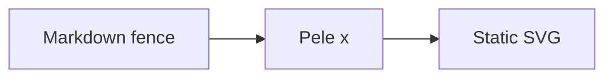

Pele x turns Mermaid fences into inline SVG at build time. Diagrams are themeable, accessible, and require no browser JavaScript unless optional zoom is enabled.

## Choose your setup

- Use the [Astro integration](astro/) directly in any Astro site.
- Use the [Starlight plugin](starlight/) to add diagrams and the matching Starlight theme together.
- Follow the [installation guide](install/) to add the packages to your project.

Use either `mermaid` or `pele` as the fence language. Other code fences are left unchanged.
