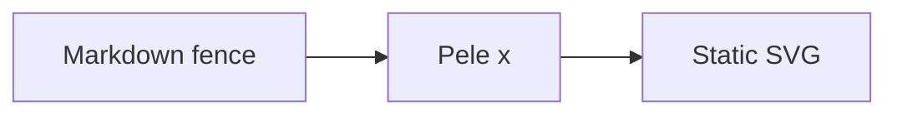

---

title: Pele x
description: Render Mermaid diagrams as static, themeable SVG in Astro and Starlight.
---

Pele x turns Mermaid fences into inline SVG at build time. Diagrams are themeable, accessible, and require no browser JavaScript unless optional zoom is enabled.

## Why static SVG?

Rendering diagrams during the build keeps pages fast. The browser does not download a Mermaid runtime, parse diagram source, or execute layout code. The SVG that reaches readers is small, predictable, and styled with the same CSS variables as the rest of the page.

## Where Pele x fits

- The [tutorials](./tutorial/getting-started-starlight/) are the best place to render your first diagram: [Starlight](./tutorial/getting-started-starlight/) or [Astro](./tutorial/getting-started-astro/).
- The [how-to guides](./how-to/install/) cover installation, authoring, and theming for specific goals.
- The [reference](./reference/starlight/) lists every integration option and the diagram gallery.
- The [explanation](./explanation/troubleshooting/) section describes how rendering works and how to fix common problems.

Use either `mermaid` or `pele` as the fence language. Other code fences are left unchanged.
