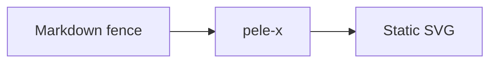

---

title: pele-x
description: Native Pele integrations for mdast, Astro and Starlight.
---

import { CardGrid, LinkCard } from '@astrojs/starlight/components';

pele-x brings [Pele](https://pele.run), the fast Mermaid-to-SVG renderer, into the JavaScript ecosystem. It turns Mermaid fences into inline SVG at build time, so diagrams are themeable and accessible without shipping a browser-side Mermaid runtime.

## Packages

<CardGrid>
	<LinkCard
		title="mdast-pele"
		description="Core renderer plus remark and Sätteri adapters."
		href="https://npmx.dev/package/mdast-pele"
	/>
	<LinkCard
		title="astro-pele"
		description="Astro integration, component, neutral theme and zoom script."
		href="https://npmx.dev/package/astro-pele"
	/>
	<LinkCard
		title="starlight-pele"
		description="Starlight plugin and light/dark theme."
		href="https://npmx.dev/package/starlight-pele"
	/>
	<LinkCard
		title="GitHub repository"
		description="Source, examples, issues and release history."
		href="https://github.com/t128n/pele-x"
	/>
</CardGrid>

All three packages are published on [npmx](https://npmx.dev). The packages use the `*-pele` naming convention because they integrate Pele into each ecosystem.

## Why static SVG?

Rendering diagrams during the build keeps pages fast. The browser does not download a Mermaid runtime, parse diagram source, or execute layout code. The SVG that reaches readers is small, predictable, and styled with the same CSS variables as the rest of the page.

## Start here

- [Choose an integration](./guides/choose-integration/) if you are not sure which package fits your site.
- [Get started with Starlight](./guides/getting-started-starlight/), [Astro](./guides/getting-started-astro/), or [mdast](./guides/getting-started-mdast/) to render your first diagram.
- [Author diagrams](./guides/authoring/) to add captions, zoom markers, MDX content, and clear errors.
- [Reference](./reference/mdast/) lists the package options and the diagram gallery.
- [Troubleshooting](./explanation/troubleshooting/) explains how rendering works and how to fix common problems.

Use either `mermaid` or `pele` as the fence language. Other code fences are left unchanged.
