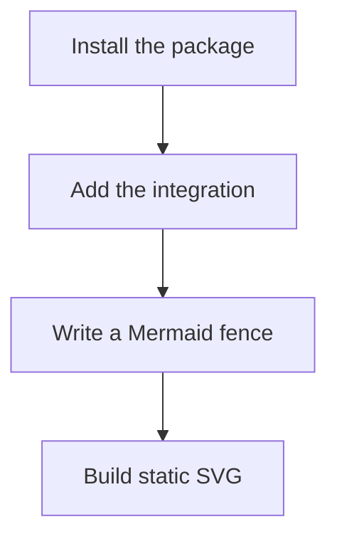

---

title: Installation
description: Install Pele x for Astro or Starlight and render your first diagram.
---

Install the integration that matches your site.

For Astro:

```sh
bun add @pele-x/astro pele
```

For Starlight:

```sh
bun add @pele-x/starlight @pele-x/astro @pele-x/mdast pele
```

Add the integration to your Astro or Starlight configuration, then write a Mermaid fence:



Production builds throw on invalid diagrams by default. During development, invalid diagrams render a readable placeholder instead.
