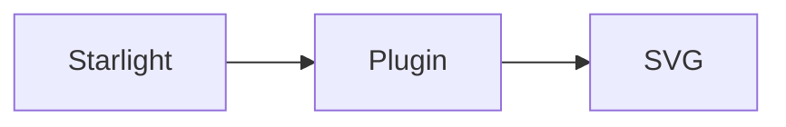

---

title: Starlight plugin
description: Add static Mermaid diagrams and Starlight theming with one plugin.
---

Use `starlight-pele` when your documentation site already uses Starlight. Pass `starlightPele()` to Starlight's `plugins` option in `astro.config.mjs`:

**Package:** [`starlight-pele` on npmx](https://npmx.dev/package/starlight-pele) · [Source](https://github.com/t128n/pele-x/tree/main/packages/starlight)

```js
import starlight from '@astrojs/starlight';
import { starlightPele } from 'starlight-pele';
import { defineConfig } from 'astro/config';

export default defineConfig({
	integrations: [
		starlight({
			title: 'My docs',
			plugins: [starlightPele()],
		}),
	],
});
```

The plugin adds the Astro integration and registers its theme automatically. Diagram colors follow Starlight's light and dark themes through Starlight CSS variables. The integration uses [`astro-pele`](./astro/) and the [`mdast-pele`](./mdast/) renderer.



You can pass the same error, language, rendering, and zoom options to `starlightPele()` as to the Astro integration.
