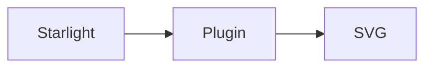

---

title: Starlight plugin
description: Add static Mermaid diagrams and Starlight theming with one plugin.
---

Use `@pele-x/starlight` when your documentation site already uses Starlight. Pass `starlightPele()` to Starlight's `plugins` option in `astro.config.mjs`:

```js
import starlight from '@astrojs/starlight';
import { starlightPele } from '@pele-x/starlight';
import { defineConfig } from 'astro/config';

export default defineConfig({
	integrations: [
		starlight({
			title: 'My docs',
			plugins: [starlightPele()],
		}),
	],
});
```

The plugin adds the Astro integration and registers its theme automatically. Diagram colors follow Starlight's light and dark themes through Starlight CSS variables.



You can pass the same error, language, rendering, and zoom options to `starlightPele()` as to the Astro integration.
