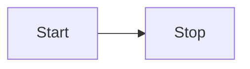

---

title: Get started with Astro
description: Add static Mermaid diagrams to a plain Astro site.
---

This tutorial adds Pele x to an existing Astro site without Starlight. By the end you will have a built page that contains a static SVG diagram and no browser-side Pele JavaScript.

## Install the package

```sh
bun add astro-pele pele
```

`mdast-pele` is installed automatically as a dependency of `astro-pele`. You only need the two packages above.

## Add the integration

Open `astro.config.mjs` and register the integration:

```js
import { pele } from 'astro-pele';
import { defineConfig } from 'astro/config';

export default defineConfig({
	integrations: [pele()],
});
```

The integration supports Astro's default `satteri()` processor and the `unified()` processor from `@astrojs/markdown-remark`. It selects the matching adapter automatically.

## Write your first diagram

Create or edit a Markdown or MDX page and add a fenced `mermaid` block:

````md

````

The `title="..."` metadata adds a caption below the diagram.

## Build the site

Run the build:

```sh
bun run build
```

Open the built page. The fence has been replaced by an inline SVG.

## Next steps

- Learn how to write [diagrams, captions and zoom markers](../how-to/authoring/).
- Browse the [diagram examples](../reference/examples/) to see what Pele can render.
