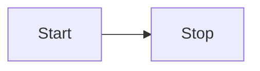

---

title: Get started with Starlight
description: Add static Mermaid diagrams to a Starlight site.
---

This tutorial adds Pele x to an existing Starlight site. By the end you will have a built page that contains a static SVG diagram and no browser-side Pele JavaScript.

## Install the package

```sh
bun add starlight-pele pele
```

`astro-pele` and `mdast-pele` are installed automatically as dependencies of `starlight-pele`. You only need the two packages above.

## Add the plugin

Open `astro.config.mjs` and register the plugin:

```js
import starlight from '@astrojs/starlight';
import { starlightPele } from 'starlight-pele';
import { defineConfig } from 'astro/config';

export default defineConfig({
	integrations: [
		starlight({
			title: 'My docs',
			plugins: [starlightPele()],
		}),
	],
});
```

The plugin adds the Astro integration and its Starlight theme automatically.

## Write your first diagram

Create or edit a docs page and add a fenced `mermaid` block:

````md

````

The `title="..."` metadata adds a caption below the diagram.

## Build the site

Run the build:

```sh
bun run build
```

Open the built page. The fence has been replaced by an inline SVG styled with your Starlight theme.

## Next steps

- Learn how to write [diagrams, captions and zoom markers](../how-to/authoring/).
- Browse the [diagram examples](../reference/examples/) to see what Pele can render.
