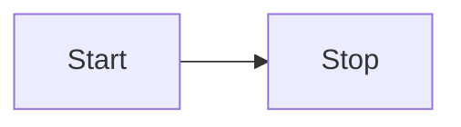

---

title: Getting started with Pele x
description: Render your first static Mermaid diagram in a Starlight or Astro site.
---

This tutorial walks you through installing Pele x and rendering your first diagram. By the end you will have a built page that contains a static SVG diagram and no browser-side Pele JavaScript.

## Install the package

Pick the integration that matches your site.

For a Starlight site:

```sh
bun add starlight-pele astro-pele mdast-pele pele
```

For a plain Astro site:

```sh
bun add astro-pele pele
```

## Add the integration

Open `astro.config.mjs` and register the plugin or integration.

Starlight:

```js
import starlight from '@astrojs/starlight';
import { starlightPele } from 'starlight-pele';
import { defineConfig } from 'astro/config';

export default defineConfig({
	integrations: [
		starlight({
			title: 'My docs',
			plugins: [starlightPele()],
		}),
	],
});
```

Astro:

```js
import { pele } from 'astro-pele';
import { defineConfig } from 'astro/config';

export default defineConfig({
	integrations: [pele()],
});
```

## Write your first diagram

Create or edit a Markdown or MDX page and add a fenced `mermaid` block:

````md

````

The `title="..."` metadata adds a caption below the diagram.

## Build the site

Run the build:

```sh
bun run build
```

Open the built page. The fence has been replaced by an inline SVG. The diagram uses your site's color theme and keeps the same accessibility ids every time you build.

## Next steps

- Read the [installation guide](../how-to/install/) for a quick command summary.
- Learn how to write [diagrams, captions and zoom markers](../how-to/authoring/).
- Browse the [diagram examples](../reference/examples/) to see what Pele can render.
