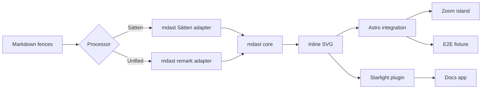
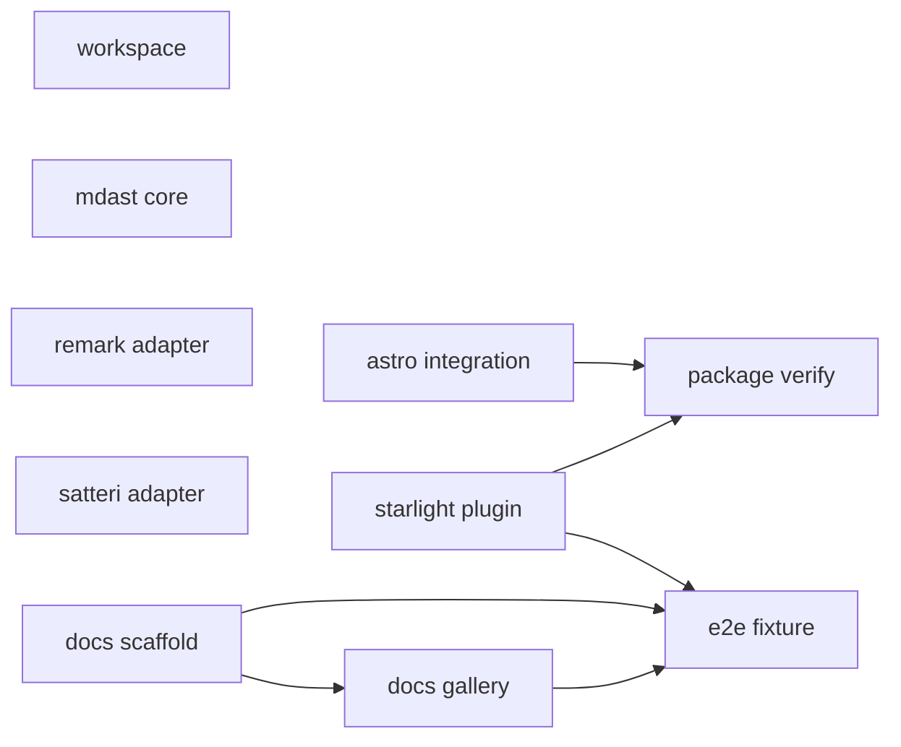

# pele-x machine plan

**Review plan:** docs/plans/2026-10-25-pele-x.review.md
**Goal:** Ship `@pele-x/mdast`, `@pele-x/astro` and `@pele-x/starlight`, rendering Mermaid fences to static, themeable SVG in Astro 7, Starlight and remark/Sätteri pipelines, plus a Starlight docs site.
**Architecture:** A framework-agnostic core renders and wraps SVG; two mdast adapters map fence nodes; the Astro integration injects the right adapter and optional zoom script; the Starlight plugin adds the integration and a theme.
**Tech stack:** Bun 1.4.3, TypeScript 6.0.3, tsdown 0.23.2, Biome 2.6.3, Astro 7.4.2, Starlight 0.42.7, Sätteri 0.10.5, Unified 11, Pele 1.10.0.
**Spec:** docs/plans/2026-10-25-pele-x.review.md
**Covers:** Summary · What you will get · What will be built · How it fits together · How it gets built · Decisions you can change · Risks · Out of scope · How we will know it works · Rough time and cost
**Detail:** contracts
**Target-min:** 40

## Global constraints

- Packages `@pele-x/mdast`, `@pele-x/astro`, `@pele-x/starlight` at `0.1.0`, `"private": true`; rename the scope only before a first publish.
- Fence languages `mermaid` and `pele`, case-sensitive; other languages untouched.
- Wrapper `<figure class="pele-diagram">` with optional `<figcaption>` from `title="..."`.
- `errorMode` defaults to `throw` in build and `placeholder` in dev; `warn` reports and renders the placeholder.
- Zoom defaults to `false`; `true` marks every diagram, `'marked'` only fences with `zoom`; the client script loads only when enabled.
- No Pele JavaScript when zoom is off; `pele` is build-time only.
- Starlight maps `--pele-*` to `--sl-color-*`; captions and error text are HTML-escaped.
- Strict ESM TypeScript, LF, tabs; tests use `bun:test`; builds use `tsdown`.
- Root `bun run check` must pass: lint, typecheck, unit tests, package builds, e2e, verification.
- Do not edit `.superlite/`; commits go through `commit_task`.

## Main diagram



## File structure

```text
root: manifests, shared tsconfig, Biome, changesets, CI, workspace test
mdast: package + src/{index,core,meta,id,errors,types,remark,satteri}.ts + three tests
astro: package + src/{index,zoom}.ts + Pele.astro + theme.css + test
starlight: package + src/index.ts + theme.css + test
docs: Starlight app + content.config.ts + custom.css + eight guide/gallery pages
example: Astro fixture + three pages; scripts: e2e and package verification
```

## Task graph

```mermaid
%% schedule
gantt
  title Predicted schedule (mm:ss)
  dateFormat X
  axisFormat %M:%S
  section lane 1
  T6 docs scaffold :t6, 0, 149s
  T7 docs gallery and guides :t7, 149, 157s
  T8 E2E fixture :t8, 306, 176s
  section lane 2
  T4 Astro integration :t4, 0, 140s
  T9 package verification :t9, 140, 141s
  section lane 3
  T0 workspace foundation :t0, 0, 123s
  section lane 4
  T1 mdast core :t1, 0, 121s
  section lane 5
  T5 Starlight plugin :t5, 0, 105s
  section lane 6
  T2 remark adapter :t2, 0, 101s
  section lane 7
  T3 Sätteri adapter :t3, 0, 101s
```





critical path: T6 → T7 → T8 (8.0 min) · peak width 7 · predicted build 8.0 min · predicted total ≈ 11.5 min (target ✓)

## Workspace

**Probe entry:** run=bun test tests/workspace.test.ts

### T0 workspace foundation · Complexity 5

**Owns:** package.json, tsconfig.base.json, biome.json, .gitignore, .changeset/config.json, .github/workflows/ci.yml, tests/workspace.test.ts, packages/*/package.json, packages/*/tsconfig.json, packages/*/tsdown.config.ts, apps/docs/package.json, apps/docs/tsconfig.json, examples/astro-basic/package.json, examples/astro-basic/tsconfig.json
**Components:** 1
**LOC owned:** 260
**Tests:** fast
**Kind:** design
**Model:** sonnet
**Produces:** workspace manifests, shared tsconfig and scripts
**Review Focus:** workspaces are `packages/*`, `apps/*`, `examples/*`; `packageManager` is `bun@1.4.3`; the three `@pele-x/*` manifests are `0.1.0` and private; astro tsconfig maps mdast subpaths to source.
**Notes:** Pin Astro 7.4.2, Starlight 0.42.7, Pele 1.10.0, TS 6.0.3, Sätteri 0.10.5, Unified 11, tsdown 0.23.2, Biome 2.6.3. Exports: mdast remark/satteri; astro zoom/Pele.astro/theme.css; starlight theme.css.

## mdast package

**Probe entry:** call=renderFenceToHtml · run=bun test packages/mdast

### T1 mdast core · Complexity 5

**Owns:** packages/mdast/src/index.ts, packages/mdast/src/types.ts, packages/mdast/src/meta.ts, packages/mdast/src/id.ts, packages/mdast/src/errors.ts, packages/mdast/src/core.ts, packages/mdast/test/core.test.ts
**Components:** 1
**LOC owned:** 240
**Tests:** fast
**Kind:** design
**Model:** sonnet
**Produces:** renderFenceToHtml(source: string, meta: FenceMeta, context: FenceContext, options?: PelePluginOptions) -> string · parseFenceMeta(meta: string | null | undefined) -> FenceMeta · diagramId(fileURL: string | undefined, index: number, source: string) -> string · isPeleLang(lang: string | null | undefined, options?: PelePluginOptions) -> boolean · renderDiagram(source: string, options?: RenderOptions) -> RenderResult · clearRenderCache() -> void
e.g. parseFenceMeta('title="Arch" zoom') -> { title: 'Arch', zoom: true }
e.g. isPeleLang('mermaid') -> true
e.g. renderFenceToHtml('flowchart LR\n A-->B', {}, { index: 0 }) -> '<figure class="pele-diagram"...'
e.g. renderDiagram('flowchart LR\n A-->B') -> { svg: '<svg...', width: 160, height: 64, type: 'flowchart' }
**Review Focus:** figure and svg; error `a.md:3`; escaped title and placeholder; ids differ by index; cache equal.
**Notes:** `FenceMeta` `{ title?: string; zoom: boolean }`; `FenceContext` `{ index; fileURL?; line?; report? }`. Cache a capped Map; error line is `context.line + error.line - 1`; placeholder `<pre class="pele-error" role="alert">`.

### T2 remark adapter · Complexity 3

**Owns:** packages/mdast/src/remark.ts, packages/mdast/test/remark.test.ts
**Components:** 1
**LOC owned:** 90
**Tests:** fast
**Kind:** design
**Model:** sonnet
**Consumes:** renderFenceToHtml(source: string, meta: FenceMeta, context: FenceContext, options?: PelePluginOptions) -> string (T1) · parseFenceMeta(meta: string | null | undefined) -> FenceMeta (T1) · isPeleLang(lang: string | null | undefined, options?: PelePluginOptions) -> boolean (T1)
**Produces:** remarkPele(options?: PelePluginOptions) -> RemarkTransformer
e.g. remarkPele() -> a transformer that replaces mermaid and pele code nodes with html nodes
**Review Focus:** mermaid yields `<svg`; a `ts` fence stays a code block; `title="Arch"` yields `<figcaption>Arch</figcaption>`; position preserved.
**Notes:** Export `RemarkTransformer = (tree: Root, file?: { path?: string; history?: string[] }) => void`; use `unist-util-visit`; replace with `{ type: 'html', value, position: node.position }`.

### T3 Sätteri adapter · Complexity 3

**Owns:** packages/mdast/src/satteri.ts, packages/mdast/test/satteri.test.ts
**Components:** 1
**LOC owned:** 90
**Tests:** fast
**Kind:** design
**Model:** sonnet
**Consumes:** renderFenceToHtml(source: string, meta: FenceMeta, context: FenceContext, options?: PelePluginOptions) -> string (T1) · parseFenceMeta(meta: string | null | undefined) -> FenceMeta (T1) · isPeleLang(lang: string | null | undefined, options?: PelePluginOptions) -> boolean (T1)
**Produces:** satteriPele(options?: PelePluginOptions) -> MdastPluginDefinition
e.g. satteriPele() -> { name: 'pele', options: { position: true }, code(node, ctx) { ... } }
**Review Focus:** mermaid yields `<svg`; a `ts` fence stays a code block; `B{Works?}` is diagram text; bad source with `errorMode: 'placeholder'` yields `.pele-error`.
**Notes:** Return `{ raw: html, mdxExpressions: false }`. Use `ctx.fileURL?.pathname`, `node.position?.start.line` and `ctx.indexOf(node)`; forward `ctx.report({ message, node, severity: 'warning' })` for `warn`.

## Astro integration

**Probe entry:** call=pele · run=bun test packages/astro

### T4 Astro integration · Complexity 5

**Owns:** packages/astro/src/index.ts, packages/astro/src/zoom.ts, packages/astro/src/Pele.astro, packages/astro/theme.css, packages/astro/test/integration.test.ts
**Components:** 2
**LOC owned:** 200
**Tests:** fast
**Kind:** design
**Model:** sonnet
**Consumes:** renderDiagram(source: string, options?: RenderOptions) -> RenderResult (T1) · remarkPele(options?: PelePluginOptions) -> RemarkTransformer (T2) · satteriPele(options?: PelePluginOptions) -> MdastPluginDefinition (T3)
**Produces:** pele(options?: AstroPeleOptions) -> AstroIntegration · resolveOptions(command: 'dev' | 'build' | 'preview', options?: AstroPeleOptions) -> AstroPeleOptions
e.g. pele({ zoom: 'marked' }) -> an AstroIntegration named '@pele-x/astro'
e.g. resolveOptions('build', {}) -> { errorMode: 'throw' }
e.g. resolveOptions('dev', {}) -> { errorMode: 'placeholder' }
**Review Focus:** Sätteri gets one mdast plugin; unified gets one remark plugin; unknown processor throws; `zoom: true` injects the zoom module and `false` does not; dev resolves `placeholder`.
**Notes:** Push into `config.markdown.processor.options`; inject once with a WeakSet. `zoom` truthy calls `injectScript('page', 'import "@pele-x/astro/zoom"')`; `zoom.ts` uses `enableZoom` on `[data-pele-zoom]`; `Pele.astro` renders `renderDiagram(source)`.

### T5 Starlight plugin · Complexity 4

**Owns:** packages/starlight/src/index.ts, packages/starlight/theme.css, packages/starlight/test/index.test.ts
**Components:** 1
**LOC owned:** 120
**Tests:** fast
**Kind:** design
**Model:** sonnet
**Consumes:** pele(options?: AstroPeleOptions) -> AstroIntegration (T4)
**Produces:** starlightPele(options?: StarlightPeleOptions) -> StarlightPlugin
e.g. starlightPele() -> { name: '@pele-x/starlight', hooks: { 'config:setup' } }
**Review Focus:** adds `@pele-x/astro`; appends `@pele-x/starlight/theme.css`; second setup does not duplicate; CSS maps `--pele-bg` to `var(--sl-color-bg)`.
**Notes:** `config:setup({ config, addIntegration, updateConfig })`; append the theme only if absent. Map `--pele-bg`, `--pele-fg`, `--pele-muted`, `--pele-line`, `--pele-surface`, `--pele-surface-alt`, `--pele-border`, `--pele-accent` to Starlight variables.

## Docs app

**Probe entry:** run=bun run --cwd apps/docs build

### T6 docs scaffold · Complexity 4

**Owns:** apps/docs/astro.config.mjs, apps/docs/src/content.config.ts, apps/docs/src/styles/custom.css, apps/docs/src/content/docs/index.md, apps/docs/src/content/docs/install.md, apps/docs/src/content/docs/astro.md, apps/docs/src/content/docs/starlight.md
**Components:** 1
**LOC owned:** 180
**Tests:** slow
**Kind:** design
**Model:** sonnet
**Consumes:** starlightPele(options?: StarlightPeleOptions) -> StarlightPlugin (T5)
**Review Focus:** root build then docs build exits 0; `dist/index.html` has `<svg` and `pele-diagram`; built CSS has `--pele-bg`.
**Notes:** `astro.config.mjs` uses `starlight({ title: 'Pele x', plugins: [starlightPele()] })`; `content.config.ts` uses `docsLoader()` and `docsSchema()`. Index and install pages include a mermaid fence.

### T7 docs gallery and guides · Complexity 5

**Owns:** apps/docs/src/content/docs/authoring.md, apps/docs/src/content/docs/theming.md, apps/docs/src/content/docs/diagrams.mdx, apps/docs/src/content/docs/troubleshooting.md
**Components:** 1
**LOC owned:** 240
**Tests:** slow
**Kind:** design
**Model:** sonnet
**Review Focus:** `dist/diagrams/index.html` has >=8 `<svg`; `Works?` appears as text; gallery has no `data-pele-zoom`; troubleshooting covers processor, zoom and duplicate ids.
**Notes:** Gallery uses `title="..."` captions for flowchart, sequence, class, state, ER, gantt, pie and git. Authoring covers fence languages, metadata and error modes. Theming lists `--pele-*` and the Starlight mapping.

## E2E and packaging

**Probe entry:** run=bun run scripts/e2e.ts

### T8 E2E fixture · Complexity 5

**Owns:** examples/astro-basic/astro.config.mjs, examples/astro-basic/src/pages/index.md, examples/astro-basic/src/pages/mdx.mdx, examples/astro-basic/src/pages/zoom.md, scripts/e2e.ts
**Components:** 2
**LOC owned:** 200
**Tests:** slow
**Kind:** design
**Model:** sonnet
**Consumes:** pele(options?: AstroPeleOptions) -> AstroIntegration (T4)
**Review Focus:** default build has svg and no `data-pele-zoom`; `PELE_PROCESSOR=unified` build has svg; `Works?` in `mdx/index.html`; `PELE_ZOOM=marked` adds `data-pele-zoom` plus a chunk containing it; docs build has svg.
**Notes:** Use `unified()` from `@astrojs/markdown-remark` when `PELE_PROCESSOR=unified`, always add `mdx()`, pass `pele({ zoom: process.env.PELE_ZOOM === 'marked' ? 'marked' : false })`. Remove each `dist` first; build packages once at script start.

### T9 package verification · Complexity 3

**Owns:** scripts/verify-dist.ts
**Components:** 1
**LOC owned:** 120
**Tests:** slow
**Kind:** design
**Model:** sonnet
**Produces:** verifyDist() -> Promise<void>
**Review Focus:** each package has `dist/index.js` and `dist/index.d.ts`; `./zoom`, `./Pele.astro`, `./theme.css` exist; publint and attw exit 0; Node imports each package.
**Notes:** Use `Bun.spawn`; fail on non-zero; check astro files and mdast subpaths.

## Review Focus

- mdast: deep, encoding, state. Risks: quote/escape handling, PeleError line mapping, cache collisions, duplicate ids, Sätteri position cost.
- astro: protocol, encoding, state. Risks: processor injection idempotency, unsupported processor, zoom loaded when off, build/dev defaults.
- starlight: protocol, state. Risks: duplicate CSS/integration, theme variable names, light/dark switching.
- docs: encoding, file. Risks: broken MDX braces, missing built packages, stale dist.
- scripts: file, state. Risks: dist reuse between runs, env leakage, package tarballs missing exports.

## Self-review

1. Coverage: every review-plan part maps to T0-T9; docs, theming, zoom, errors and packaging each have a task.
2. Placeholders: none; every Consumes matches a Produces; core types are in T1.
3. Graph: execution edges only, no cycles; parallel tasks own disjoint files.
4. Measurables: every task has Components/LOC/Tests/Kind/Model; lint and schedule pass.

Ruling: sequential [chain-ef64] - docs config must exist before its pages and the e2e docs check depends on those pages - costs 4.9 min
