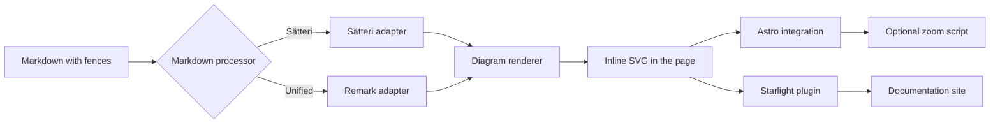
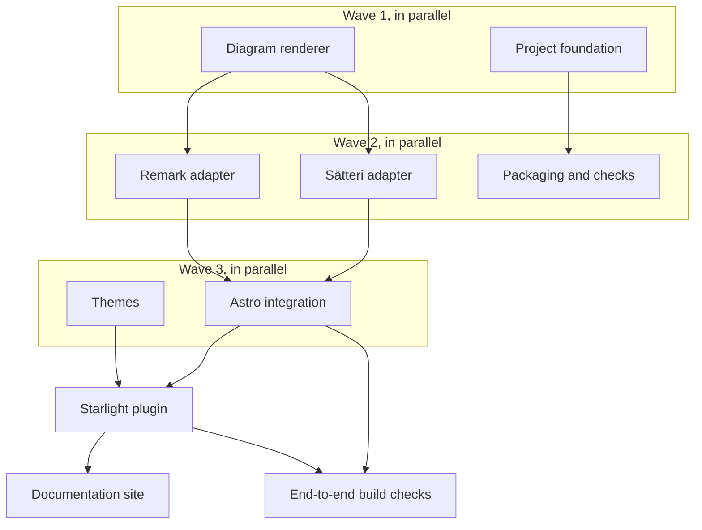

# pele-x: Astro + Starlight integration for Pele — review plan

## Summary

Pele (pele.run) is a fast, dependency-free renderer that turns Mermaid text into themeable SVG. This project builds a small monorepo that lets Astro and Starlight documentation sites render Mermaid fences as static SVG at build time, with no browser JavaScript by default. It also ships a portable mdast plugin for plain remark and unified pipelines, so the same behaviour works outside Astro, including in MDX. The monorepo includes a Starlight documentation site that uses the integration itself.

## What you will get

- A Starlight plugin that turns `mermaid` and `pele` fences into inline SVG with roughly two lines of configuration.
- An Astro integration for sites that do not use Starlight.
- A framework-agnostic mdast plugin with two adapters: Sätteri, which is Astro 7's default processor, and remark/unified.
- Light and dark theming through Starlight's CSS variables, plus a neutral theme for plain Astro sites.
- Optional pan and zoom on diagrams, off by default and about 3 KB gzipped when enabled.
- Useful failures: a broken diagram stops a production build with its file and line, while the dev server shows a readable placeholder instead of a blank page.
- Captions and per-diagram options through fence metadata.
- A documentation site that covers installation, authoring, theming, supported diagram types and troubleshooting.
- Tests that exercise both processors, MDX, theming, zoom and the published package shape.

## What will be built

| Part | What it does | Size | Built by |
|---|---|---|---|
| Diagram renderer | Turns a Mermaid fence into stable inline SVG with unique accessibility ids, a small cache and clear errors | M | a careful helper |
| Sätteri adapter | Plugs the renderer into Astro 7's default Markdown processor | S | a fast helper |
| Remark adapter | Plugs the same renderer into standard remark and unified pipelines | S | a fast helper |
| Astro integration | Wires the adapter automatically, applies the error policy and injects the optional zoom script | M | a careful helper |
| Starlight plugin | Adds the Astro integration and the light/dark theme to a Starlight site | M | a careful helper |
| Documentation site | A Starlight site with install guides, authoring, theming, a diagram gallery and troubleshooting | M | a careful helper |
| Packaging and checks | Produces publishable packages, type declarations and package-quality checks | M | a careful helper |
| Project foundation | Bun workspaces, formatting, linting, test commands and continuous integration | S | a fast helper |

## How it fits together

## How it gets built

## Decisions you can change

- Package names: `@pele-x/*` (default) | unscoped `pele-*` | a scope you already own on npm.
- Fence languages: `mermaid` and `pele` (default) | `mermaid` only | any list you choose.
- Broken diagrams: fail the production build and show a placeholder in development (default) | always show a placeholder | always fail.
- Zoom: off by default; when enabled it can cover every diagram or only fences marked `zoom`.
- Output wrapper: a figure with an optional caption from fence metadata (default) | bare SVG only.
- Documentation: the full Starlight site (default) | package READMEs only.
- Tooling: Bun workspaces and Bun's test runner (default) | pnpm and Vitest.
- TypeScript: 6.0.3 (default) | 7.0.2, once the Astro checker supports it.

## Risks

- Astro 7's Markdown processor is new, and the integration relies on a small internal seam to add plugins. We keep both adapters usable on their own, add a clear fallback message, and pin and test against Astro 7.
- Sätteri and remark differ in node handling and source positions. We test the same fixtures through both pipelines and through MDX, including labels with braces.
- Pele reuses readable element ids inside diagrams, so two diagrams can share ids. We give each diagram a unique accessibility prefix and test multi-diagram pages.
- Client JavaScript can creep in. Zoom is opt-in, measured at about 3 KB gzipped, and the default build ships no Pele JavaScript.
- Starlight's theme variables can change between releases. We pin the tested Starlight version, use documented variables and keep a fallback palette.
- A third-party Pele Markdown package already exists. We keep our own thin renderer and adapters so the monorepo does not depend on an unmaintained package.
- The npm scope may not be available. Packages start private at version 0.1.0, and the scope can be renamed before the first release.

## Out of scope

- A live playground or in-browser editor.
- Rendering diagrams per request at runtime; the focus is build-time static output.
- Fixing Mermaid syntax or rendering gaps inside Pele.
- Integrations for other frameworks such as Next.js or VitePress; the remark adapter will work there, but it will not be documented or tested.
- Publishing to npm or creating a remote Git repository without a separate approval.
- Translated documentation.

## How we will know it works

- One install command and two lines of Starlight configuration produce a page where a Mermaid fence is an inline SVG.
- The same page builds correctly with Astro's default Sätteri processor and with the Unified processor.
- An MDX page with a decision node such as `B{Works?}` renders the braces as diagram text, not as an MDX expression.
- A broken diagram fails a production build with the source file and line, while the dev server shows a placeholder.
- Light and dark Starlight themes recolor diagrams without re-rendering them.
- Zoom is absent by default; enabling it adds only the small zoom script and allows panning and zooming.
- Two diagrams on one page have distinct accessibility ids.
- The docs site builds, its examples render, and the package tarballs pass package-quality checks and a Node import smoke test.
- The full check command passes from a clean install.

## Rough time and cost

About 60 to 120 minutes and roughly $15 to $35 (rough, until the machine plan is linted).
