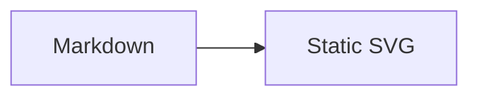

# astro-pele

Astro integration that renders Mermaid fences to static, themeable SVG with [Pele](https://pele.run).

## Install

```sh
npm install astro-pele pele
```

## Setup

```js
// astro.config.mjs
import { defineConfig } from 'astro/config';
import { pele } from 'astro-pele';

export default defineConfig({
	integrations: [pele()],
});
```

Then use a normal Mermaid fence:

````md

````

## Zoom

Pass `pele({ zoom: true })` to enable pan and zoom on every diagram, or `pele({ zoom: 'marked' })` and add `zoom` to selected fences.

The package also exports a `<Pele />` component and `astro-pele/theme.css`.

Full docs: https://t128n.github.io/pele-x/
