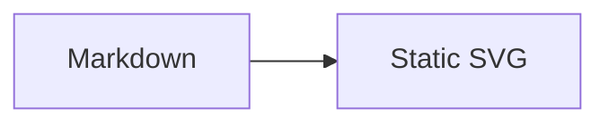
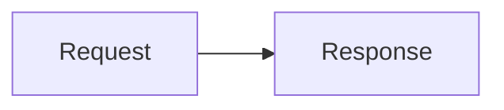

# mdast-pele

Render Mermaid fences to static SVG with [Pele](https://pele.run) in remark and Sätteri pipelines.

The browser needs no JavaScript. The generated SVG is themed with CSS variables, works in Markdown and MDX, and can be styled from the surrounding page.

## Why static SVG?

Rendering diagrams during the build keeps pages fast. The browser does not download a Mermaid runtime, parse diagram source, or execute layout code. The SVG that reaches readers is small, predictable, and styled with the same CSS variables as the rest of the page.

`mdast-pele` replaces matching mdast `code` nodes with raw HTML figures. It works with any unified/remark pipeline and with Sätteri's mdast plugin API.

## Install

```sh
npm install mdast-pele
```

The package is ESM-only and requires Node.js 20 or later.

## Remark

````js
import { unified } from 'unified';
import remarkParse from 'remark-parse';
import { remarkPele } from 'mdast-pele/remark';
import remarkRehype from 'remark-rehype';
import rehypeStringify from 'rehype-stringify';

const html = unified()
	.use(remarkParse)
	.use(remarkPele)
	.use(remarkRehype, { allowDangerousHtml: true })
	.use(rehypeStringify, { allowDangerousHtml: true })
	.processSync('```mermaid\nflowchart LR\n A --> B\n```')
	.toString();
````

`remarkPele` must run before `remark-rehype`. The generated figure is raw HTML, so keep `allowDangerousHtml` enabled on both `remark-rehype` and `rehype-stringify`.

## Sätteri

```js
import { markdownToHtml } from 'satteri';
import { satteriPele } from 'mdast-pele/satteri';

const { html } = markdownToHtml(source, {
	mdastPlugins: [satteriPele()],
});
```

The Sätteri adapter returns raw HTML with `mdxExpressions: false`, so braces in diagram labels stay diagram text instead of becoming MDX expressions.

## Astro

Use the `astro-pele` integration instead of wiring the plugin into Astro manually:

```sh
npm install astro-pele pele
```

```js
// astro.config.mjs
import { defineConfig } from 'astro/config';
import { pele } from 'astro-pele';

export default defineConfig({
	integrations: [pele()],
});
```

Import `astro-pele/theme.css` for a neutral light and dark theme. The integration supports Astro's `satteri()` processor and the `unified()` processor from `@astrojs/markdown-remark`.

## Starlight

Use the `starlight-pele` plugin when your site already uses Starlight:

```sh
npm install starlight-pele
```

```js
// astro.config.mjs
import { defineConfig } from 'astro/config';
import starlight from '@astrojs/starlight';
import { starlightPele } from 'starlight-pele';

export default defineConfig({
	integrations: [
		starlight({
			title: 'Docs',
			plugins: [starlightPele()],
		}),
	],
});
```

The plugin registers the Astro integration and maps Pele's CSS variables to Starlight's light and dark theme.

## Writing diagrams

Use `mermaid` or `pele` as the fence language. Language names are case-sensitive; every other fence is left unchanged.

````md

````

### Captions

Add `title="..."` to a fence to render a `<figcaption>`. Single-quoted titles are also supported.

````md

````

### Zoom

Add the standalone `zoom` marker to a fence and set the plugin option to `"marked"`:

````md

````

`remarkPele` and `satteriPele` only add `data-pele-zoom` to the figure. The `astro-pele` integration injects the browser module that handles pan and zoom. When rendering outside Astro, provide your own zoom behavior for marked figures.

## Options

Both `remarkPele(options)` and `satteriPele(options)` accept `PelePluginOptions`:

| Option      | Type                                 | Default               | Description                                                                  |
| ----------- | ------------------------------------ | --------------------- | ---------------------------------------------------------------------------- |
| `languages` | `readonly string[]`                  | `['mermaid', 'pele']` | Fence languages to replace. Matching is case-sensitive.                      |
| `errorMode` | `'throw' \| 'placeholder' \| 'warn'` | `'throw'`             | How to handle invalid diagrams. See [Error handling](#error-handling).       |
| `zoom`      | `boolean \| 'marked'`                | `false`               | Mark every diagram for zoom, or only fences with the `zoom` metadata marker. |

All Pele `RenderOptions` are forwarded unchanged. Commonly used options include:

| Pele option      | Description                                              |
| ---------------- | -------------------------------------------------------- |
| `fontFamily`     | Font stack used for diagram labels.                      |
| `fontFamilyMono` | Font stack used for monospace parts.                     |
| `fontSize`       | Base font size for diagram text.                         |
| `monospace`      | Parts rendered with the monospace font.                  |
| `responsive`     | Adapt the SVG to the available container width.          |
| `maxWidth`       | Maximum rendered width.                                  |
| `autoDirection`  | Choose a diagram direction based on the available width. |
| `padding`        | Inner padding around the diagram.                        |
| `limit`          | Source size limit enforced by Pele.                      |
| `outputLimit`    | Output size limit enforced by Pele.                      |
| `maxEdges`       | Maximum number of edges in a diagram.                    |
| `links`          | Enable or disable links in rendered diagrams.            |
| `linkSchemes`    | Allowed URL schemes for links.                           |
| `images`         | Enable or disable images in rendered diagrams.           |
| `imageSchemes`   | Allowed URL schemes for images.                          |
| `linkRel`        | `rel` attribute applied to rendered links.               |
| `icons`          | Resolver for diagram icons.                              |
| `math`           | Resolver for math markup.                                |
| `config`         | Pele configuration overrides.                            |
| `measurer`       | Custom text measurer.                                    |
| `now`            | Timestamp used by time-dependent diagrams.               |

See the [Pele API documentation](https://pele.run/api) for the complete option reference and default values.

`mdast-pele` generates an `idPrefix` for each fence. Do not override `idPrefix` when using the plugins, because generated accessibility ids must stay unique.

## Error handling

`errorMode` controls invalid diagrams:

- `throw` stops the build and includes the source file and mapped line. This is the default for `remarkPele` and `satteriPele`.
- `placeholder` renders an escaped, readable error inside `<pre class="pele-error" role="alert">`.
- `warn` renders the same placeholder and reports a warning when the adapter supports reporting. The Sätteri adapter forwards warnings through `ctx.report`.

The `astro-pele` integration uses `throw` during builds and `placeholder` during development and preview. An explicit `errorMode` always wins.

## Theming

Pele diagrams use CSS variables, so colors follow the surrounding theme without re-rendering the SVG.

| Variable             | Controls                    |
| -------------------- | --------------------------- |
| `--pele-bg`          | Diagram background          |
| `--pele-fg`          | Primary text and foreground |
| `--pele-muted`       | Secondary text              |
| `--pele-line`        | Connectors and lines        |
| `--pele-surface`     | Node surfaces               |
| `--pele-surface-alt` | Alternate surfaces          |
| `--pele-border`      | Borders and outlines        |
| `--pele-accent`      | Accent elements             |

Override the variables on `.pele-diagram` or any ancestor:

```css
.pele-diagram {
	--pele-bg: #fffdf5;
	--pele-fg: #292524;
	--pele-line: #78716c;
	--pele-surface: #f5f5f4;
	--pele-surface-alt: #e7e5e4;
	--pele-border: #d6d3d1;
	--pele-accent: #b45309;
}
```

`astro-pele/theme.css` provides a neutral light and dark palette. The Starlight plugin maps Pele variables to Starlight's theme variables automatically.

## API

The package exports the remark and Sätteri adapters plus lower-level helpers:

```js
import {
	clearRenderCache,
	diagramId,
	isPeleLang,
	parseFenceMeta,
	renderDiagram,
	renderFenceToHtml,
} from 'mdast-pele';
```

### `renderDiagram(source, options?)`

Calls Pele's `render()` directly and returns its result:

```js
import { renderDiagram } from 'mdast-pele';

const { svg, width, height, type } = renderDiagram('flowchart LR\n A --> B');
```

### `renderFenceToHtml(source, meta, context, options?)`

Renders one fence to the `<figure>` markup used by the adapters. The context supplies the fence index, optional file URL, source line, and optional warning reporter.

### `clearRenderCache()`

Clears the internal render cache. The cache is bounded to 100 entries and is keyed by source, metadata, id prefix, and render options.

### `diagramId(fileURL, index, source)`

Returns the deterministic `pele-…` id prefix used for a fence. It changes with the file, fence index, and source.

### `parseFenceMeta(meta)`

Parses `title="..."` and the `zoom` marker from fence metadata.

### `isPeleLang(lang, options?)`

Returns whether a fence language is handled by the plugin.

## Security

Pele escapes diagram text, filters links and styles, and enforces source and output limits. See [Pele's security documentation](https://pele.run/security) for the full model.

`mdast-pele` emits raw HTML because diagrams are inline SVG. Enable `allowDangerousHtml` only for content you trust. For user-generated diagrams, validate or sandbox the source and restrict `linkSchemes` and `imageSchemes` as needed.

## Compatibility

- Node.js 20 or later.
- ESM only; use `import`, not `require`.
- remark/unified and Sätteri pipelines.
- Astro and Starlight through the companion packages.
- Markdown and MDX. Fenced diagrams keep braces, such as `B{Works?}`, as diagram text.

## Troubleshooting

### No SVG appears

Check that the fence language is exactly `mermaid` or `pele`, that `remarkPele` runs before `remark-rehype`, and that raw HTML is enabled. In Astro, confirm that the integration is registered before building.

### An MDX page fails on braces

Keep Mermaid syntax inside a fenced code block rather than an inline MDX expression. Update to a build that includes the MDX-safe adapter if an older configuration evaluates braces.

### Duplicate accessibility ids

Do not reuse rendered SVG markup for multiple fences and do not assign the same `idPrefix` manually. The supplied adapters generate deterministic ids from the file, fence position, and source.

### Zoom does not work

Zoom is off by default. Set `zoom: true` for every diagram, or `zoom: 'marked'` together with the `zoom` fence marker. The `astro-pele` integration injects the browser module only when zoom is enabled.

### Error line numbers are confusing

Pele reports 1-based lines inside the fence body. `mdast-pele` adds the fence's opening line so errors point at the source document. Include the file URL in the remark or Sätteri context to get file-qualified messages.

## Development

From the repository root:

```sh
bun install
bun run build
bun test
bun run check
```

The package-level test command is:

```sh
bun --filter mdast-pele test
```

## License

MIT
