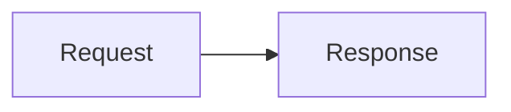

# mdast-pele

Use `mdast-pele` when a Markdown or MDX pipeline should turn Mermaid fences into inline SVG at build time. Diagrams are rendered by [Pele](https://pele.run), require no browser JavaScript, and inherit colors from CSS variables.

## Install

```sh
npm install mdast-pele
```

The package is ESM-only and requires Node.js 20 or later.

## Remark

```js
import { unified } from 'unified';
import remarkParse from 'remark-parse';
import { remarkPele } from 'mdast-pele/remark';
import remarkRehype from 'remark-rehype';
import rehypeStringify from 'rehype-stringify';

const html = unified()
	.use(remarkParse)
	.use(remarkPele)
	.use(remarkRehype, { allowDangerousHtml: true })
	.use(rehypeStringify, { allowDangerousHtml: true })
	.processSync(source)
	.toString();
```

Run `remarkPele` before `remark-rehype`. Keep `allowDangerousHtml` enabled on both `remark-rehype` and `rehype-stringify`, because the plugin emits raw HTML figures.

## Sätteri

```js
import { markdownToHtml } from 'satteri';
import { satteriPele } from 'mdast-pele/satteri';

const { html } = markdownToHtml(source, {
	mdastPlugins: [satteriPele()],
});
```

The Sätteri adapter returns raw HTML with `mdxExpressions: false`, so braces in diagram labels remain diagram text.

## Astro and Starlight

Prefer the companion integrations instead of wiring the plugin into Astro manually.

```sh
npm install astro-pele pele
```

```js
// astro.config.mjs
import { defineConfig } from 'astro/config';
import { pele } from 'astro-pele';

export default defineConfig({
	integrations: [pele()],
});
```

For Starlight, install `starlight-pele` and add `starlightPele()` to the `plugins` array:

```js
import starlight from '@astrojs/starlight';
import { starlightPele } from 'starlight-pele';

starlight({
	title: 'Docs',
	plugins: [starlightPele()],
});
```

## Fence syntax

Use `mermaid` or `pele` as the fence language. Matching is case-sensitive; other fences stay unchanged.

````md

````

- `title="..."` adds a `<figcaption>`.
- `zoom` marks the figure for pan and zoom when the plugin option is `zoom: 'marked'`.
- `zoom: true` marks every diagram.
- The mdast adapters only add `data-pele-zoom`; the `astro-pele` integration injects the browser module that handles zoom.

## Options

`remarkPele(options)` and `satteriPele(options)` accept:

| Option      | Type                                 | Default               | Description                                               |
| ----------- | ------------------------------------ | --------------------- | --------------------------------------------------------- |
| `languages` | `readonly string[]`                  | `['mermaid', 'pele']` | Fence languages to replace.                               |
| `errorMode` | `'throw' \| 'placeholder' \| 'warn'` | `'throw'`             | Fail the build, render a placeholder, or render and warn. |
| `zoom`      | `boolean \| 'marked'`                | `false`               | Mark all diagrams, or only fences with the `zoom` marker. |

All Pele `RenderOptions` are forwarded unchanged, including `fontFamily`, `fontSize`, `responsive`, `maxWidth`, `links`, `linkSchemes`, `images`, `imageSchemes`, `limit`, `outputLimit`, and `maxEdges`. Do not set `idPrefix`; the adapters generate a unique prefix for each fence.

## Error handling

- `throw` stops the build and reports the source file and mapped line. This is the default.
- `placeholder` emits `<pre class="pele-error" role="alert">` with escaped text.
- `warn` emits the placeholder and forwards a warning through the Sätteri context when available.

The `astro-pele` integration defaults to `throw` during builds and `placeholder` in development and preview.

## Theming

Override Pele CSS variables on `.pele-diagram` or an ancestor:

```css
.pele-diagram {
	--pele-bg: #fffdf5;
	--pele-fg: #292524;
	--pele-line: #78716c;
	--pele-surface: #f5f5f4;
	--pele-surface-alt: #e7e5e4;
	--pele-border: #d6d3d1;
	--pele-accent: #b45309;
}
```

`astro-pele/theme.css` provides a neutral light and dark palette. The Starlight plugin maps the variables to Starlight's theme.

## API helpers

```js
import {
	clearRenderCache,
	diagramId,
	isPeleLang,
	parseFenceMeta,
	renderDiagram,
	renderFenceToHtml,
} from 'mdast-pele';
```

- `renderDiagram(source, options?)` calls Pele directly.
- `renderFenceToHtml(source, meta, context, options?)` renders one fence to the adapter's figure markup.
- `clearRenderCache()` clears the bounded render cache.
- `diagramId(fileURL, index, source)` returns the deterministic fence id prefix.
- `parseFenceMeta(meta)` parses `title` and `zoom`.
- `isPeleLang(lang, options?)` reports whether a fence language is handled.

## Common mistakes

- Running `remarkPele` after `remark-rehype` leaves code fences untouched.
- Forgetting `allowDangerousHtml` produces escaped or missing SVG.
- Using the wrong case, such as `Mermaid`, leaves the fence unchanged.
- Copying rendered HTML into multiple places can duplicate accessibility ids; render each fence through the adapter.
- Passing `idPrefix` manually can break id uniqueness.

## Verify the result

After a build, check that the output contains `<figure class="pele-diagram">` and an inline `<svg>`. For invalid diagrams, check the reported file and line, or temporarily use `errorMode: 'placeholder'` to see the message in the output.

## Links

- Documentation: https://t128n.github.io/pele-x/
- Pele API: https://pele.run/api
- Issues: https://github.com/t128n/pele-x/issues
