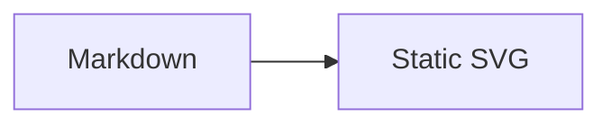

# starlight-pele

Starlight plugin that renders Mermaid fences to themeable SVG with [Pele](https://pele.run).

It adds the Astro integration, maps Pele's colors to Starlight's light and dark theme, and leaves no client JavaScript unless zoom is enabled.

## Install

```sh
npm install starlight-pele
```

## Setup

```js
// astro.config.mjs
import { defineConfig } from 'astro/config';
import starlight from '@astrojs/starlight';
import { starlightPele } from 'starlight-pele';

export default defineConfig({
	integrations: [starlight({ title: 'Docs', plugins: [starlightPele()] })],
});
```

Then use a normal Mermaid fence:

````md

````

Add `zoom` to a fence for pan and zoom, or pass `starlightPele({ zoom: true })` to enable it everywhere.

Full docs: https://t128n.github.io/pele-x/
